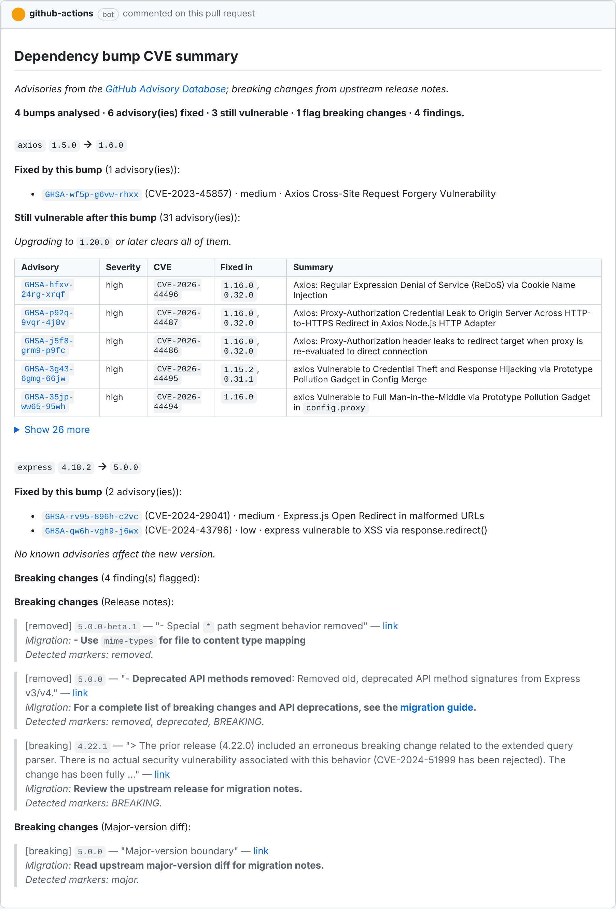

# Bivouac: know what a dependency bump fixes and breaks

[](https://github.com/marketplace/actions/bivouac-dependency-bump-advisor)
[](https://github.com/Bivouac-VE/Bivouac-Action/releases)
[](https://github.com/Bivouac-VE/Bivouac-Action/actions/workflows/test.yml)
[](./LICENSE)

A free GitHub Action that comments on Dependabot, Renovate and manual
dependency-bump pull requests with:

- **the advisories the bump fixes**,
- **the advisories still open after it**, and the lowest version that clears them all,
- **breaking changes** quoted from the upstream release notes, with links.

Works for **npm** (including lockfile-only bumps of indirect dependencies),
**Python** and **Go**. No account, no API key, no LLM: it uses the
[GitHub Advisory Database](https://github.com/advisories) and your workflow's
built-in token.



_Excerpt of a real comment the Action posted on a PR bumping axios and express._

## Quickstart

Add `.github/workflows/bivouac.yml`:

```yaml
name: Bivouac

on:
  pull_request:
    types: [opened, synchronize, reopened]

permissions:
  pull-requests: write # to post the comment
  contents: read

jobs:
  bivouac:
    runs-on: ubuntu-latest
    steps:
      - uses: Bivouac-VE/bivouac-action@v1
```

That's it. The next dependency PR gets one comment, which is updated in place
when the PR changes. Checkout is not needed: the Action reads the changed files
through the GitHub API.

## What it adds to Dependabot and Renovate

Dependabot and Renovate open the PR. The Action adds the context a reviewer
needs on the PR itself, so nobody has to dig through advisories and
changelogs:

- **What the bump fixes.** The advisories it clears, with links, so security
  bumps are easy to spot and prioritise in a busy queue.
- **Anything still open.** If the new version still has known advisories,
  they are listed with the version that clears them all.
- **Breaking changes.** Release-note lines that rename or remove an API are
  quoted on the PR, with a link, before anyone clicks merge.

It adds a review step on top of Dependabot, Renovate or Snyk. It doesn't
replace any of them.

## Supported files

| Ecosystem | Files read | Advisories | Release notes |
| --- | --- | --- | --- |
| npm | `package.json`, `package-lock.json`, `npm-shrinkwrap.json` | ✓ | ✓ (via the npm registry → GitHub Releases / CHANGELOG.md) |
| Python | `requirements*.txt` (pinned `==`), `poetry.lock`, `uv.lock` | ✓ | ✓ (via PyPI project URLs) |
| Go | `go.mod` | ✓ | ✓ (for `github.com/…` and `golang.org/x/…` modules) |

Lockfiles matter: when Dependabot fixes a vulnerable **indirect** dependency it
often changes only `package-lock.json`. The Action reads lockfiles, marks those
packages as indirect, and prefers the exact installed version when both the
manifest and the lockfile change.

On very large lockfile-maintenance PRs the Action analyses up to 40 bumps,
direct dependencies first, and says how many it skipped.

## What the comment contains

For each bumped package:

1. **Fixed by this bump**: advisories that affected the old version but not the new one.
2. **Still vulnerable after this bump**: advisories that still affect the new version,
   with each fixed-in version and the lowest version that clears them all. Long
   lists collapse after five rows.
3. **Breaking changes**: release-note lines marked `BREAKING`, "breaking change(s)",
   `major:`, `removed` or `deprecated API`, plus a note when the bump crosses a
   major version. Negated mentions such as "no breaking changes" are ignored.

When breaking changes are found, the Action also adds a warning block to the PR
description (between `<!-- bivouac-action:pr-warnings:start -->` and `…:end -->`
markers, replaced on each run, with the rest of the description untouched).
If that update fails, the job logs a warning and carries on.

If the advisory database can't be reached, the comment says so instead of
reporting a false "no advisories". Withdrawn advisories are ignored.

## Inputs

| Name | Required | Default | Description |
| --- | --- | --- | --- |
| `github-token` | no | `${{ github.token }}` | Token used to read files and post the PR comment. |
| `comment-marker` | no | `<!-- bivouac-action -->` | Marker used to find and update the Action's comment. Change it to run two configurations side by side. |

## Outputs

| Name | Description |
| --- | --- |
| `cve-summary` | JSON array of `{ name, from, to, cves, breakingChanges }`, one entry per bump. |
| `breaking-summary` | JSON array of `{ name, from, to, breakingChanges }` for bumps with breaking-change markers. |
| `breaking-change-summary` | JSON array of `{ name, from, to, findings }` with `category`, `summary`, `migrationNote`, `version`, `url`, `markers` per finding. |
| `comment-id` | ID of the posted or updated PR comment. |
| `pr-warning-count` | Number of packages with at least one breaking-change finding. |
| `pr-description-updated` | `"true"` if the PR description got the warnings block. |

## Permissions and privacy

- Needs only `pull-requests: write`. `contents: write` is not required.
- Calls the GitHub REST API (changed files, advisories, release notes, the
  comment) and the public npm and PyPI registries (to find each package's
  repository). Nothing is sent to Bivouac or any other service.

## FAQ

**Does it work on forks?** On `pull_request` events from forks, GitHub gives the
token read-only access, so the comment can't be posted. Dependabot and Renovate
PRs come from branches in your repo, so they work.

**Does it block merging?** No. It only comments. It never fails the check
because of findings.

**What's next?** Maven, Cargo, RubyGems, and yarn/pnpm lockfiles. Ask for the
one you need in [Discussions](https://github.com/Bivouac-VE/Bivouac-Action/discussions).

## About Bivouac

This Action is the free "investigate" step of [Bivouac](https://getbivouac.com).
The hosted product goes further: it picks the fix, runs your own tests in a
sandbox and opens the PR only when they pass. Installing this Action does not
enable any of that.

## Contributing

Bug reports, false positives and ecosystem requests are very welcome. See
[CONTRIBUTING.md](./CONTRIBUTING.md). To report a security issue, see
[SECURITY.md](./SECURITY.md).

```bash
npm ci
npm test          # node --test
npm run typecheck # tsc --noEmit
npm run build     # bundles dist/index.js (commit it)
```

## License

[MIT](./LICENSE)
